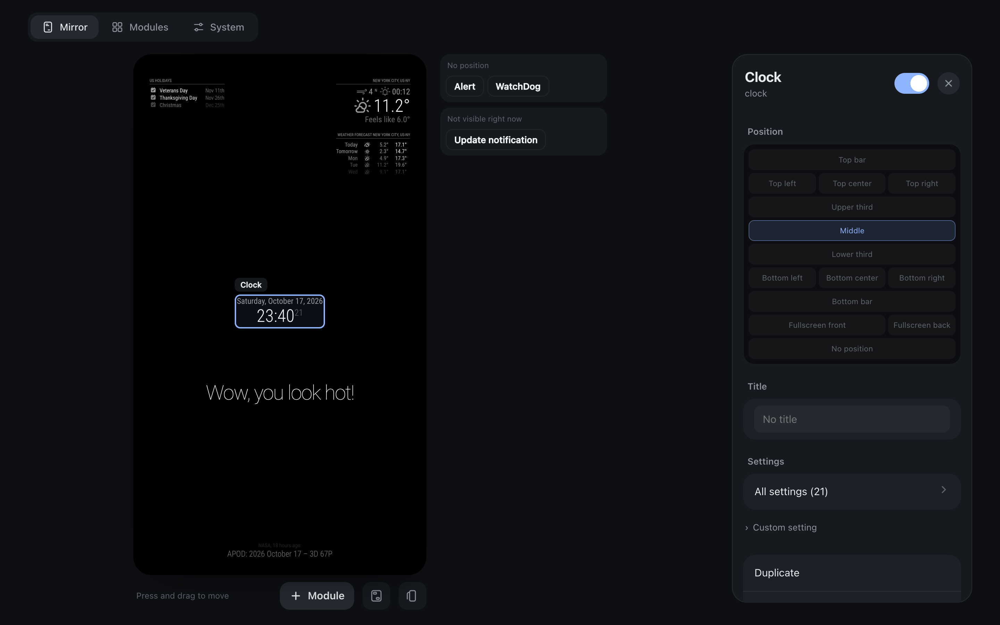
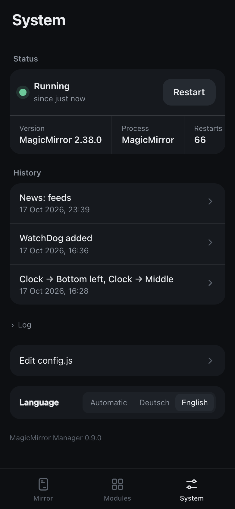

# MagicMirror Manager

A small web app to manage the modules of a [MagicMirror²](https://magicmirror.builders/), from your phone or laptop, without ever breaking the mirror.

- **Arrange** modules with drag and drop on a **live preview** of your mirror. The preview already shows your unsaved changes, with real content.
- **Configure** modules without touching code: switches, fields, dropdowns and forms for lists. Default values and possible choices are read straight from each module's source code.
- **Find and install** modules from the [official module list](https://modules.magicmirror.builders/).
- **Update** modules (checked automatically every 6 hours), see what changed, and undo an update with one tap. Uninstalled modules go to a trash you can restore from.
- **Update MagicMirror itself**, with the same safety net.
- **Seasonal modules:** suggestions for Halloween, Christmas, winter, New Year and more when the time comes, and a yearly date window per module ("show only from 15 Oct until 1 Nov"). The manager switches such modules on and off by itself, with the usual check and rollback.
- **Undo** any change from the history.

<p align="center">
  
</p>

<p align="center">
  
  
  
</p>

It is a single Node.js process with **no dependencies** (no `npm install`), plus a plain JavaScript web app. The interface is available in German and English.

> Not affiliated with the MagicMirror² project.

## Why another tool?

Existing tools work, but they share a few weak spots, and when something goes wrong the mirror stays black:

| Problem | How the manager handles it |
|---|---|
| The tool runs *inside* MagicMirror as a module, so when a bad config stops the mirror, the tool is gone too. | It runs as its **own process**. It keeps working when MagicMirror doesn't, and can repair it. |
| `config.js` is regenerated from scratch: comments, functions and formatting are lost. | Only the **exact spot** that changes is edited. Comments, functions, regular expressions and `${ENV}` placeholders stay as they are. |
| Changes are written straight away, without a check and without a way back. | Changes are **collected first**, then applied in one go. Every apply is **checked, backed up, restarted, verified and rolled back automatically** if the mirror doesn't come up. |

### What "apply" does

1. **Check:** The new config is parsed and evaluated the way MagicMirror does it, including `config.env` variables. Every enabled module must be installed. Then MagicMirror's own checker (`js/check_config.js`) runs on it. If anything fails, nothing is written.
2. **Back up:** The current `config.js` goes into the history (the last 50 versions are kept).
3. **Write:** The new file is written atomically, so a crash never leaves half a file.
4. **Restart** MagicMirror through pm2.
5. **Verify:** The manager waits until MagicMirror answers again, then keeps watching for ten more seconds. It counts as failed if:
   - the process crashes or pm2 restarts it,
   - the web server doesn't answer,
   - the log shows a fatal config error.
6. **Roll back:** If the check fails, the previous `config.js` is put back, MagicMirror is restarted, and you see the reason together with the relevant log lines.

Module updates work the same way:

1. The module folder is copied.
2. `git pull --ff-only` runs.
3. `npm install` runs only if `package.json` or the lock file changed.
4. The mirror is restarted and verified.
5. If anything fails, the old folder comes back.

Updating MagicMirror itself:

1. The Node.js version required by the new release is checked first.
2. The `node_modules` folder is renamed (instant, no extra space).
3. `git pull` runs, then MagicMirror's own install script.
4. The mirror is restarted and verified.
5. If anything fails, git goes back to the old version and the old `node_modules` folder comes back.

New modules are cloned next to the modules folder first and only moved into place once the install has finished, so an aborted install leaves nothing behind. Uninstalled modules go to a trash folder instead of being deleted.

## Requirements

- MagicMirror² (tested with 2.38), started with **pm2** (the usual setup on a Raspberry Pi)
- Node.js 22 or newer (MagicMirror itself already needs that)
- `git` and `npm` (already there if you installed MagicMirror)

## Install on the mirror

Run this on the Raspberry Pi as the user that runs MagicMirror:

```bash
cd ~
git clone https://github.com/jjoeojieajfhpdsonf/magicMirrorManager.git magicmirror-manager
cd magicmirror-manager
sh tools/install.sh
```

The script:

1. checks Node.js, pm2 and the MagicMirror folder,
2. starts the manager with pm2 as `mm-manager`,
3. saves the pm2 process list so the manager comes back after a reboot,
4. prints the address to open.

The manager listens on port **8090**: open `http://<your-pi>:8090` (often `http://magicmirror.local:8090`) and add it to your phone's home screen. The live preview uses the next port (8091).

Update the manager later with:

```bash
cd ~/magicmirror-manager && git pull && pm2 restart mm-manager
```

### Settings

Everything has sensible defaults. Override with environment variables when needed, e.g. `MM_DIR=/opt/MagicMirror sh tools/install.sh`.

| Variable | Default | Meaning |
|---|---|---|
| `MM_DIR` | `~/MagicMirror` | MagicMirror folder |
| `MM_CONFIG_FILE` | `config/config.js` | Config file, if you use a different one |
| `MM_PM2_NAME` | detected | Name or id of the MagicMirror process in pm2. By default the process running from `MM_DIR` (or one named `mm`/`MagicMirror`) is used. |
| `MM_RESTART_CMD` | – | Use a shell command instead of pm2 to restart MagicMirror, e.g. `docker restart magicmirror` or `systemctl --user restart magicmirror`. The manager then verifies via HTTP only. |
| `MM_URL` | from `config.js` | Address of MagicMirror's web server, if it can't be derived |
| `MM_START_TIMEOUT` | `90` | Seconds to wait for MagicMirror to come up |
| `PM2_BIN` | `pm2` | Path to pm2 |
| `PASSWORD` | – | Optional password for the web app (and the live preview) |
| `PORT` / `HOST` | `8090` / `0.0.0.0` | Where the manager listens |
| `PREVIEW_PORT` | `PORT + 1` | Port of the live preview, `0` turns it off |
| `UPDATE_CHECK_HOURS` | `6` | How often module updates are checked in the background |
| `DATA_DIR` | `./data` | Draft, history, backups, trash, cached module list |

## Live preview

The mirror tab shows the real MagicMirror page, scaled down, with your collected (not yet applied) changes. How it works:

- The manager serves MagicMirror through a small proxy on its own port.
- It swaps in the draft config.
- It adds a tiny script that reports where each module is drawn, so you can click and drag the real modules.

Two limits:

- Modules that run code on the server (`node_helper`) and were only just added show their data once the change is applied, because MagicMirror loads them at start.
- The preview talks to the running MagicMirror like a second screen would. Modules with hardware (sensors, buttons) are better tested on the mirror itself. The eye button switches to a plain sketch.

## Security

The manager can change your config and install software. Without a password it is open to everyone who can reach it, like MagicMirror itself. Keep it on your **home network or behind a VPN** such as Tailscale and never forward it to the internet.

To require a password, start it with one:

```bash
PASSWORD='choose-a-good-one' sh tools/install.sh
```

The live preview port is protected by the same login: without it, the preview would expose your mirror even if MagicMirror's own `ipWhitelist` is strict.

## Try it without a mirror

```bash
npm run demo
```

This starts a demo on <http://localhost:8090> with a simulated mirror (data in `./data-demo`). Edits, backups, rollbacks and even installs from GitHub work for real on the demo files. Only the restart is simulated.

## Development

```bash
npm test                     # unit tests (config editing, parser)
MM_DIR=~/MagicMirror MM_PM2_NAME=MagicMirror node test/integration.js
```

The integration test runs against a real MagicMirror under pm2:

- it changes the config and restores it at the end,
- it installs and updates [MMM-SimpleText](https://github.com/SaltyRiver/MMM-SimpleText),
- it uses a module that crashes on purpose to check the automatic rollback.

Don't point it at a mirror you care about.

How the code is organised:

| File | Purpose |
|---|---|
| `server.js` | HTTP server and API |
| `lib/jsparse.js` | Small JavaScript scanner that finds objects and arrays in `config.js` with their exact source ranges |
| `lib/config.js` | Edits (move, toggle, set option …) and validation |
| `lib/mirror.js` | MagicMirror paths, pm2 control and the health check |
| `lib/modules.js` | Install, update with backup/rollback, uninstall |
| `lib/catalog.js` | The official module list, cached for offline use |
| `lib/core.js` | Updating MagicMirror itself |
| `lib/preview.js` | Live preview proxy (draft config, stale-page guard) |
| `lib/choices.js` | Finds the possible values of an option in the module's code |
| `public/` | The web app (no build step) |

`test/fixtures/sample.config.js` is MagicMirror's sample config (MIT license).

## License

MIT
